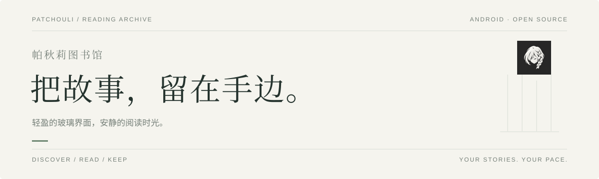
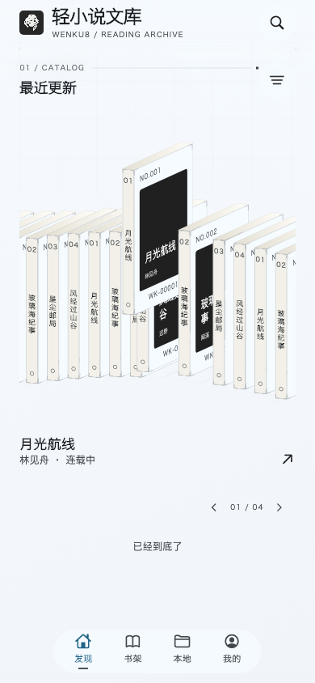
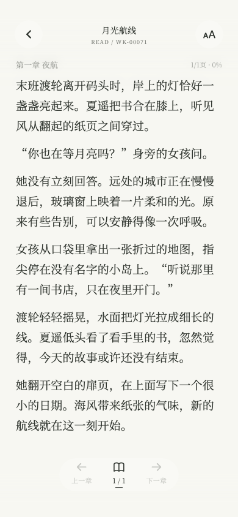
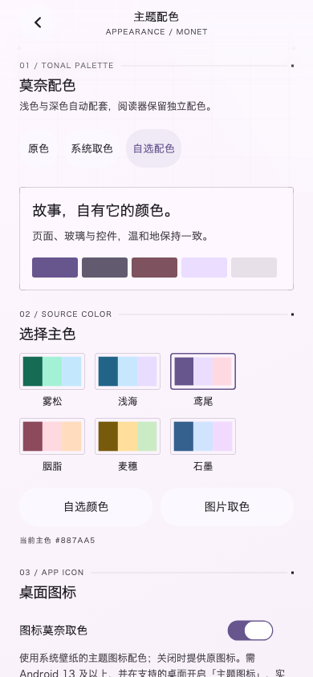

# 轻小说文库 · Wenku8 Flutter

> [!IMPORTANT]
> **本项目仅为第三方阅读客户端，提供阅读界面与本地书籍管理，不运营在线书库、不自行发布小说资源，安装包不附带小说文件。在线内容及可读状态一切以 Wenku8 为准；不提供因版权限制而停止开放的在线书籍阅读。**
>
> **本项目完全免费、开源，无任何赞助、打赏或付费渠道。** 不出售会员、激活码或功能解锁服务。任何以本项目或开发者名义收费、募捐、索要赞助的行为均与本项目无关，请勿付款。
>
> **仅支持轻小说文库及本地导入，不再支持其他源或自定义书源。** 面向 Android 手机与平板，并非轻小说文库网站的官方应用。

## 下载与更新

当前正式版：**[0.4.6 · build 163](https://github.com/mikufoxxx/Wenku8_Flutter/releases/tag/v0.4.6)**。

本版改善官网阅读与访问验证后的恢复，修复中文用户名输入，并让试读缓存与收藏书架分开，避免只看一眼就自动上架。

### [镜像下载 →](https://git.3952039.xyz/#releases)　[GitHub Releases →](https://github.com/mikufoxxx/Wenku8_Flutter/releases/latest)

| 你的设备 | 选择安装包 |
| :-- | :-- |
| 近年的 Android 手机、平板 | **arm64-v8a（推荐）** |
| 旧款 32 位 ARM 设备 | armeabi-v7a |
| x86_64 设备或模拟器 | x86_64 |

**沿用原包名与签名，可直接覆盖升级，不要先卸载旧版。** 升级、整理存储或同步前，请先备份重要数据。

App 内打开 **我的 → 关于 → 检查更新**，优先走镜像，连接失败时自动回退到 GitHub，无需选择线路。

[完整更新说明](CHANGELOG.md) · [阅读指南](docs/READER.md) · [反馈问题](https://github.com/mikufoxxx/Wenku8_Flutter/issues)

<p align="center">
  <picture>
    <source media="(prefers-color-scheme: dark)" srcset="docs/images/readme-cover-dark.svg" />
    
  </picture>
</p>

<p align="center">
  <a href="https://github.com/mikufoxxx/Wenku8_Flutter/actions/workflows/flutter-ci.yml"></a>
  <a href="https://github.com/mikufoxxx/Wenku8_Flutter/releases/latest"></a>
  <a href="https://github.com/mikufoxxx/Wenku8_Flutter/releases"></a>
  
  <a href="assets/licenses/GPL-3.0.txt"></a>
</p>

奶白玻璃、档案式排版与立体书架。从发现一本书，到整理本地书库、离线阅读和听书，让每一次打开都回到故事本身。

## 界面一览

<p align="center">
  
  &nbsp;
  
  &nbsp;
  
</p>

<p align="center"><sub>发现故事　／　沉浸阅读　／　按习惯定制<br />界面书目为演示数据</sub></p>

## 阅读，按你的习惯

- **横排、竖排或滚动**：大屏支持对页，曲面纸页随手指翻动、从书缝展开；也可选择段落接续、平移、覆盖或无动画，调整翻页速度。
- **一本书，一套排版**：字体、字号、字重、字间距、行距与四边页边距独立保存；缩进、对齐和背景浓度支持透明预览。
- **让颜色和字形合拍**：系统莫奈、自选主色或图片取色；阅读器独立配色与自定义背景。五款阅读字体按需下载、离线使用、随时删除，不预装阅读字库；也可导入 TTF／OTF，App 与阅读器分别选择。
- **随时找到读到哪里**：分卷目录、本章／整书进度、章内与整书查找、音量键翻页、自动阅读和跨章衔接。封面与插图支持双指缩放及原图保存。

## 书库，不止一种整理方式

- **立体与列表**：循环轮播、惯性吸附与触觉反馈，也可只用列表。分类、阅读状态和书籍来源一起筛选；本地书库可独立管理，也可与书架合并。
- **先选择，再导入**：支持多选文件、扫描共享存储或指定文件夹；扫描后勾选书籍再导入，同系列分卷统一确认合并。
- **默认关联原文件**：覆盖现有支持格式，也可选择复制到应用；TXT 使用目录索引，EPUB 按需读取资源，其他格式保留必要的转换文件和缓存。请保留关联的原文件；文件移动或权限失效后可重新关联，保留进度和书签。
- **保留原书的细节**：EPUB 注音、注释弹窗、常见对齐、分隔线与混合横竖排；TXT 可自定义目录。在线书籍支持章节与插图缓存，不提供整书文件下载或导出。
- **批量整理，更少重复**：多选后移动分类、移出或删除；更换封面、恢复原书封面，也可手动升级旧 EPUB 排版和整理重复资源，保留原书、目录、进度与书签。

<details>
<summary><b>支持的格式与网盘入口</b></summary>

支持 TXT、EPUB、MOBI／AZW／AZW3／PRC、FB2、PDF、DOCX、RTF、HTML、Markdown 与 ZIP。书名、作者、封面和分卷顺序可调整。

可通过 OpenList／WebDAV、夸克网盘（实验性）导入；OneDrive、Google Drive 等可使用系统云文档入口，手动合并同步原书与阅读记录。

[网盘导入指南 →](docs/CLOUD_IMPORT.md)

</details>

## 读到哪里，都能接着读

- **局域网续读**：同一 Wi-Fi 自动发现，首次两端确认后自动重连。在「目录 → 章节进度 → 在其他设备上续读」选择设备，缺书时一并传送，已有同一本书时只传位置。
- **书签与分类同步**：两台 App 保持前台时自动接续较新的进度，增量同步书签和分类；同时修改的记录可在冲突页选择保留。
- **留下喜欢的句子**：长按正文选句或段落，复制、加入书签或快速查看本卷插图。书签可分类、定位高亮，也可分享成带图标水印的图片。
- **换一种方式听故事**：自然在线音色、自定义 Microsoft SSML 接口，或手机已安装的系统 TTS 引擎。支持 0.5～3 倍速、段落跟随、睡眠定时、后台与锁屏控制；离线能力取决于引擎和音色。

<details>
<summary><b>更多：发现、账号与阅读偏好</b></summary>

- **书籍发现**：分类、排行、出版文库，按书名、作者或标签搜索；点作者或标签继续浏览相关作品。[搜索指南 →](docs/SEARCH.md)
- **账号与社区**：文库账号、云书架、书评与回复。
- **阅读操作**：分区点按、点书直接续读，再从阅读器进入详情。
- **离线与备份**：失败续缓存、缓存管理、阅读历史与本地备份。
- **主题图标**：桌面图标可跟随系统主题取色，开关独立控制。
- **中文支持**：简体中文、香港繁体与台湾繁体，可跟随系统或手动选择。
- **使用方式**：无网时保留可离线阅读的书；阅读器模式随本地／合并书架设置联动。
- **性能设置**：帧率偏好和低性能模式，玻璃折射、模糊、动效与立体书架可分别调整。

</details>

## 使用与内容说明

在线书目与内容来自轻小说文库（Wenku8），本地书籍由用户自行导入。小说、封面和插图归各自权利人所有，源码许可不授予内容使用权。请仅使用有权访问的内容，遵守来源网站规则，不得绕过访问限制、破解 DRM，或未经许可复制、传播、出售内容。

第三方服务可能调整、限流或停止。反馈问题时不要附带密码、Cookie 或令牌。

## 开发与参与

欢迎通过 [Issues](https://github.com/mikufoxxx/Wenku8_Flutter/issues) 反馈问题，或通过 Pull Request 参与开发。反馈请附 App 版本、Android 版本和复现步骤。

<details>
<summary><b>本地构建与工程说明</b></summary>

环境：Flutter 3.41.5 / Dart 3.11.3、JDK 17、Android SDK。

```sh
git clone https://github.com/mikufoxxx/Wenku8_Flutter.git
cd Wenku8_Flutter
flutter pub get
flutter build apk --release --target-platform android-arm64
```

公开工程用于本地导入、阅读器、书架与界面开发，构建为独立的「轻小说文库 · 源码预览」，不会覆盖正式版或访问其数据。

[Flutter source checks](https://github.com/mikufoxxx/Wenku8_Flutter/actions/workflows/flutter-ci.yml) 执行代码检查、测试与独立预览构建，不上传安装包或创建版本发布。

[构建指南 →](docs/RELEASING.md)

</details>

## 致谢与许可

基于 [MewX/light-novel-library_Wenku8_Android](https://github.com/MewX/light-novel-library_Wenku8_Android) 重构。感谢 MewX、Baby Pepper（SeraphRoy）、Jack Liu（aaassseee）及原项目贡献者。

- **应用源码**：保留 [GPL v2 或后续版本声明](LICENSE)，本 Flutter 组合版本按 [GPL v3](assets/licenses/GPL-3.0.txt) 分发。
- **可下载字体**：遵循各自的 SIL OFL 1.1 许可。
- **在线语音适配**：[rany2/edge-tts](https://github.com/rany2/edge-tts)，[LGPL v3](assets/licenses/edge-tts.txt)。

[NOTICE](NOTICE) · [第三方组件说明](docs/THIRD_PARTY.md) · [LINUX DO 社区](https://linux.do/)

## Star History

<a href="https://www.star-history.com/?repos=mikufoxxx%2Fwenku8_flutter&type=date&releases=&legend=bottom-right">
  <picture>
    <source media="(prefers-color-scheme: dark)" srcset="https://api.star-history.com/chart?repos=mikufoxxx/wenku8_flutter&type=date&theme=dark&legend=top-left" />
    <source media="(prefers-color-scheme: light)" srcset="https://api.star-history.com/chart?repos=mikufoxxx/wenku8_flutter&type=date&legend=top-left" />
    
  </picture>
</a>
