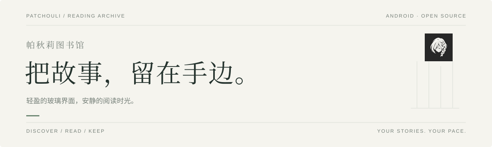
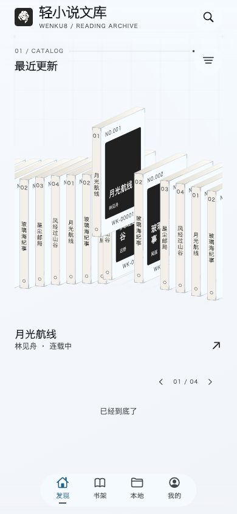
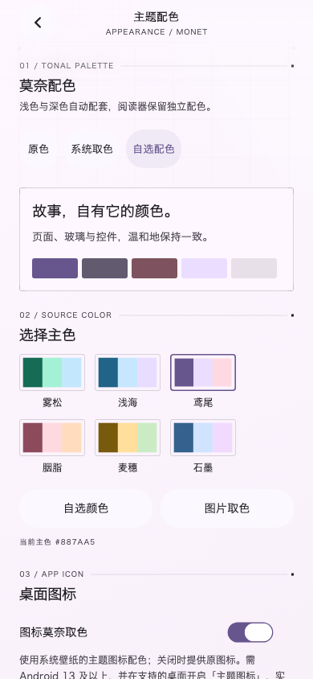

# 帕秋莉图书馆 · Patchouli Library

> [!IMPORTANT]
> 基于 [mikufoxxx/Wenku8_Flutter](https://github.com/mikufoxxx/Wenku8_Flutter) 的多源阅读客户端，提供书源导入、本地书库和阅读管理。**安装包不内置站点规则或小说文件**，在线功能由用户导入的规则提供。
>
> **本项目完全免费，无任何赞助、打赏或付费渠道。** 不出售会员、激活码或功能解锁服务。任何以本项目或开发者名义收费、募捐、索要赞助的行为均与本项目无关，请勿付款。
>
> **0.5.6（265）正式版已发布**。Android 包名为 `reader.patchoulibrary.yushio`，与旧预览版独立安装。下载入口及迁移步骤见下方。iOS／HarmonyOS 的配套源码尚未构建验收；本项目并非任何书源平台的官方应用。

## 当前版本与发布状态

当前正式版：**[0.5.6 · Android build 265](https://github.com/Dear-moon/Patchouli_Library/releases/tag/v0.5.6)**，Android 包名：`reader.patchoulibrary.yushio`。

延续 0.5.5 的包名与签名，直接覆盖升级可保留书架、设置与账号数据。

旧预览版：**[0.5.2-preview.1+262 · Android build 262](https://github.com/Dear-moon/Patchouli_Library/releases/tag/v0.5.2-preview.1%2B262)**

### 0.5.6 本轮调整

- **听书恢复**：通知等短暂打断结束后，按原播放状态恢复；手动暂停、停止或切书会取消自动恢复。
- **语音缓存与重试**：修复在线合成期间临时目录被清理导致的缓存失败；临时断线时有限重试，失败或超时后保留当前段落。
- **在线 EPUB 卷缓存**：复用并迁移已有卷册，有缓存先打开，后台静默获取更新；相同内容删除重复副本，变化的卷册在下次进入阅读器时启用，并清理旧卷、旧正文及插图缓存。
- **阅读信息显示**：新增可保存的「显示底部阅读信息」总开关，一次隐藏底栏的章节名、页码、进度、时间与电量。

上游本次发行说明见 [Wenku8 Flutter 0.5.6](https://github.com/mikufoxxx/Wenku8_Flutter/releases/tag/v0.5.6)。本版保留通用多源引擎和各源独立返回的并发搜索。

### 0.5.5 本轮调整

- Android 使用独立标识 `reader.patchoulibrary.yushio`，沿用现有签名；与旧包并存，不是旧包的覆盖升级。
- 默认备份文件名改为 `patchouli-library-backup-YYYY-MM-DD.json`，旧备份继续支持导入。
- 关于页统一显示通用多源支持说明。

## 下载与更新

### [下载 0.5.6 ARM64 APK →](https://github.com/Dear-moon/Patchouli_Library/releases/download/v0.5.6/patchouli-library-0.5.6-arm64-v8a.apk)　[全部版本 →](https://github.com/Dear-moon/Patchouli_Library/releases)

0.5.6 正式版提供 ARM64 APK，0.5.5 用户可直接覆盖更新。旧预览版与新版独立安装，请通过应用内备份迁移书架与设置，并在新版重新导入规则、登录平台。下载和版本说明以本仓库 Releases 为准。

首次安装后，在「书源管理」通过文件、链接或粘贴导入 JSON；已有规则可在导入时更新。各平台的登录、收藏、搜索和阅读能力取决于所用规则与源站。规则声明的逻辑地址需更新网页映射后，才能使用详情页的浏览器入口。

## 从旧预览版迁移

1. 在旧版「备份与恢复」导出备份，保留原书文件。旧版导出的 `wenku8-backup-日期.json` 仍可用于新版恢复。
2. 安装新包，在「备份与恢复」选择备份并合并记录，按需导入偏好设置。新旧应用独立保存数据，安装本身不会迁移书架。
3. 在新版「书源管理」重新导入规则；聚合 JSON 可一次导入多条规则。平台账号、Cookie、令牌和网盘凭据不包含在书库备份中，需要重新登录或配置。
4. JSON 备份不含本地原书和离线正文。本地书籍需保留原文件并重新导入或授予访问权限；确认新版记录与阅读正常后，再决定是否保留旧安装。

[反馈问题](https://github.com/Dear-moon/Patchouli_Library/issues) · [上游阅读指南](https://github.com/mikufoxxx/Wenku8_Flutter/blob/master/docs/READER.md)

## 仓库说明

公开发行仓库 [Dear-moon/Patchouli_Library](https://github.com/Dear-moon/Patchouli_Library) 保持上游 fork 关系，仅保留两个公开分支：`master` 原样跟随上游工程；`readme` 为默认分支，独立维护介绍、发行与使用说明。两个分支不相互合并。

**`master` 中的上游快照与 Releases 中的定制 APK 不等同，不能直接从该分支构建出帕秋莉图书馆发行包。**

  <picture>
    <source media="(prefers-color-scheme: dark)" srcset="https://raw.githubusercontent.com/Dear-moon/Patchouli_Library/v0.5.1-preview.1/docs/images/readme-cover-dark.svg" />
    
  </picture>

  
  
  
  
  

奶白玻璃、档案式排版与立体书架。从发现一本书，到整理本地书库、离线阅读和听书，让每一次打开都回到故事本身。

## 界面参考

  
  &nbsp;
  
  &nbsp;
  

发现故事　／　沉浸阅读　／　按习惯定制 图示来自上游，书目为演示数据；定制版本的部分入口有所调整

## 阅读，按你的习惯

- **横排、竖排或滚动**：大屏支持对页，曲面纸页随手指翻动、从书缝展开；也可选择段落接续、平移、覆盖或无动画，调整翻页速度。
- **一本书，一套排版**：字体、字号、字重、字间距、行距与四边页边距独立保存；缩进、对齐和背景浓度支持透明预览。
- **让颜色和字形合拍**：系统莫奈、自选主色或图片取色；阅读器独立配色与自定义背景。多款阅读字体按需下载、离线使用、随时删除，不预装阅读字库；也可导入 TTF／OTF，App 与阅读器分别选择。
- **随时找到读到哪里**：分卷目录、本章／整书进度、章内与整书查找、音量键翻页、自动阅读和跨章衔接。封面与插图支持双指缩放及原图保存；0.5.6 增加底部阅读信息总开关，可独立于系统状态栏隐藏整栏提示。
- **双语各取所需**：保留原书浅字样式，按书选择显示语言；朗读语言独立选择，每种语言可单独配置音色，缺少匹配语音模型时跳过。

## 把阅读足迹，留成一张图

- **分清每一种记录**：总览、节律、书目、记号与触摸分类查看，支持预设时间范围与自定义日期；没有数据的字段和图表自动省略。
- **报告不只是换颜色**：八套独立版式，按需选择阅读日历、节律、相伴书单、进度和摘录；预览与导出使用同一份内容。
- **为喜欢的句子留一页**：书签、批注、摘录图片与阅读纪念；四季插图随实际季节切换，保存图片使用短暂提示。

## 桌面上，也有你的阅读日常

今日阅读、本周热力、阅读日历、阅读纪念与摘录卡，搭配四季手帐等五种样式。每张小组件独立选择内容与外观，可同时放置多张；提供小、中、大三种尺寸和浅色／深色模式。

点击统计进入统计页，点击最近阅读继续上次位置，摘录卡可直接换一条。Android 使用应用内配置；上游还提供 iOS WidgetKit 与 HarmonyOS 表单实现，定制版本的这两类平台尚未构建验收。

## 书库，不止一种整理方式

- **立体与列表**：循环轮播、惯性吸附与触觉反馈，也可只用列表。分类、阅读状态和书籍来源一起筛选；本地书库可独立管理，也可与书架合并。
- **先选择，再导入**：支持多选文件、扫描共享存储或指定文件夹；扫描后勾选书籍再导入，同系列分卷统一确认合并。
- **默认关联原文件**：覆盖现有支持格式，也可选择复制到应用；TXT 使用目录索引，EPUB 按需读取资源，其他格式保留必要的转换文件和缓存。请保留关联的原文件；文件移动或权限失效后可重新关联，保留进度和书签。
- **保留原书的细节**：EPUB 注音、注释弹窗、常见对齐、分隔线与混合横竖排；TXT 可自定义目录。在线书籍支持章节与插图缓存，不提供整书文件下载或导出。
- **批量整理，更少重复**：多选后移动分类、移出或删除；更换封面、恢复原书封面，也可手动升级旧 EPUB 排版和整理重复资源，保留原书、目录、进度与书签。

<b>支持的格式与网盘入口</b>

支持 TXT、EPUB、MOBI／AZW／AZW3／PRC、FB2、PDF、DOC／DOCX、RTF、HTML、Markdown 与 ZIP。书名、作者、封面和分卷顺序可调整。

可通过 OpenList／WebDAV、夸克网盘（实验性）导入；OneDrive、Google Drive 等可使用系统云文档入口，手动合并同步原书与阅读记录。

[网盘导入指南 →](https://github.com/Dear-moon/Patchouli_Library/blob/v0.5.1-preview.1/docs/CLOUD_IMPORT.md)

## 读到哪里，都能接着读

- **局域网续读**：同一 Wi-Fi 自动发现，首次两端确认后自动重连。在「目录 → 章节进度 → 在其他设备上续读」选择设备，缺书时一并传送，已有同一本书时只传位置。
- **S3 云端同步**：通过 S3／兼容存储手动合并原书、阅读进度、书签与分类；导入连接和同步目的地分别设置。
- **离线查词**：导入 MDict、StarDict 或 Kindle 词典，在阅读时本地查词。
- **书签与分类同步**：两台 App 保持前台时自动接续较新的进度，增量同步书签和分类；同时修改的记录可在冲突页选择保留。
- **留下喜欢的句子**：长按正文选句或段落，复制、加入书签或快速查看本卷插图。书签可分类、定位高亮，也可分享成带图标水印的图片。
- **换一种方式听故事**：自然在线音色、自定义 Microsoft SSML 接口，或手机已安装的系统 TTS 引擎。支持 0.5～3 倍速、段落跟随、睡眠定时、后台与锁屏控制；离线能力取决于引擎和音色。

<b>更多：发现、账号与阅读偏好</b>

- **书籍发现**：分类、排行、出版文库，按书名、作者或标签搜索；点作者或标签继续浏览相关作品。[搜索指南 →](https://github.com/Dear-moon/Patchouli_Library/blob/v0.5.1-preview.1/docs/SEARCH.md)
- **平台账号与云端收藏**：按导入规则提供对应入口，实际可用能力取决于规则和源站。
- **阅读操作**：分区点按可选左右两侧都翻下一页；发现、书架和本地页可分别设置点书直接续读，再从阅读器进入详情。
- **离线与备份**：失败续缓存、缓存管理、阅读历史与本地备份。备份包含书架、进度、书签、历史和偏好，账号与离线正文另行管理。
- **主题图标**：桌面图标可跟随系统主题取色，开关独立控制。
- **中文支持**：简体中文、香港繁体与台湾繁体，可跟随系统或手动选择。
- **使用方式**：可在 App 内强制竖屏，不影响其他应用旋转；无网时保留可离线阅读的书，阅读器模式随本地／合并书架设置联动。
- **性能与动效**：帧率偏好和低性能模式，玻璃折射、模糊、过渡、动态图标与立体书架可分别调整；振动支持原生触感／波形切换、分类开关、强度与试振。

## 使用与内容说明

在线书目与内容由用户导入的规则从对应平台获取，本地书籍由用户自行导入。本项目不运营在线书库，也不自行发布小说资源。小说、封面和插图归各自权利人所有，源码许可不授予内容使用权。请仅使用有权访问的内容，遵守来源网站规则，不得绕过访问限制、破解 DRM，或未经许可复制、传播、出售内容。

第三方服务可能调整、限流或停止。反馈问题时不要附带密码、Cookie 或令牌。

## 开发与反馈

帕秋莉图书馆的问题请在[本仓库 Issues](https://github.com/Dear-moon/Patchouli_Library/issues) 反馈，附上 App 版本、设备与系统版本、复现步骤及相关书源名称，不要发送账号凭据。上游项目的问题与贡献请前往[上游仓库](https://github.com/mikufoxxx/Wenku8_Flutter)。

本次定制发行使用 Flutter 3.41.6／Dart 3.11.4 验证 Android 构建。公开 `master` 的构建命令和文档属于上游工程；定制功能的源码交付以具体 Release 的说明和附件为准。

## 致谢与许可

本项目 fork 自 [mikufoxxx/Wenku8_Flutter](https://github.com/mikufoxxx/Wenku8_Flutter)，保留上游作者和第三方组件的版权及许可证声明。上游基于 [MewX/light-novel-library_Wenku8_Android](https://github.com/MewX/light-novel-library_Wenku8_Android) 重构。感谢 MewX、Baby Pepper（SeraphRoy）、Jack Liu（aaassseee）及原项目贡献者。

- **应用源码**：保留 [GPL v2 或后续版本声明](https://github.com/Dear-moon/Patchouli_Library/blob/v0.5.1-preview.1/LICENSE)，本 Flutter 组合版本按 [GPL v3](https://github.com/Dear-moon/Patchouli_Library/blob/v0.5.1-preview.1/assets/licenses/GPL-3.0.txt) 分发。
- **可下载字体**：遵循各自的 SIL OFL 1.1 许可。
- **在线语音适配**：[rany2/edge-tts](https://github.com/rany2/edge-tts)，[LGPL v3](https://github.com/Dear-moon/Patchouli_Library/blob/v0.5.1-preview.1/assets/licenses/edge-tts.txt)。

[NOTICE](https://github.com/Dear-moon/Patchouli_Library/blob/v0.5.1-preview.1/NOTICE) · [第三方组件说明](https://github.com/Dear-moon/Patchouli_Library/blob/v0.5.1-preview.1/docs/THIRD_PARTY.md) · [LINUX DO 社区](https://linux.do/)

## Star History

<a href="https://www.star-history.com/?repos=Dear-moon%2FPatchouli_Library&amp;type=date&amp;legend=top-left">
  <picture>
    <source media="(prefers-color-scheme: dark)" srcset="https://api.star-history.com/chart?repos=Dear-moon%2FPatchouli_Library&amp;type=date&amp;theme=dark&amp;legend=top-left&amp;v=20261101" />
    <source media="(prefers-color-scheme: light)" srcset="https://api.star-history.com/chart?repos=Dear-moon%2FPatchouli_Library&amp;type=date&amp;legend=top-left&amp;v=20261101" />
    
  </picture>
</a>
